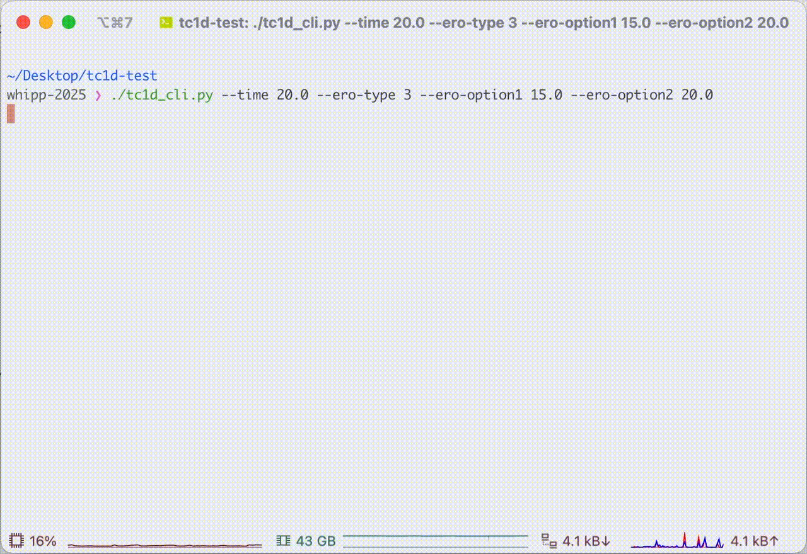

Documentation for T\ :sub:`c`\ 1D
=================================

T\ :sub:`c`\ 1D is a one-dimensional thermal and thermochronometer age prediction model that can simulate the effects of various geodynamic and geomorphic processes on thermochronometer ages.
It currently supports prediction of apatite and zircon (U-Th)/He and fission-track ages.

Check out the :doc:`usage` section for further information, including
details about :ref:`installation`.

.. note::

   This project is under active development.

Citation
--------

Use of T\ :sub:`c`\ 1D can be acknowledged by citing

Whipp, D. M., Gérard, B., Laaksonen, S., and Kellett, D. A.: Technical note: Tc1D – a 1D thermal and thermochronometer age prediction model, Geochronology, 8, 627–643, https://doi.org/10.5194/gchron-8-627-2026, 2026.

We also encourage you to `cite the relevant version of Tc1D <https://doi.org/10.5281/zenodo.7124271>`_ using the DOI from Zenodo.

Contents
--------

.. toctree::
   :caption: Using Tc1D
   :maxdepth: 2

   usage
   example-plots

.. toctree::
   :caption: Reference
   :maxdepth: 2

   reference
