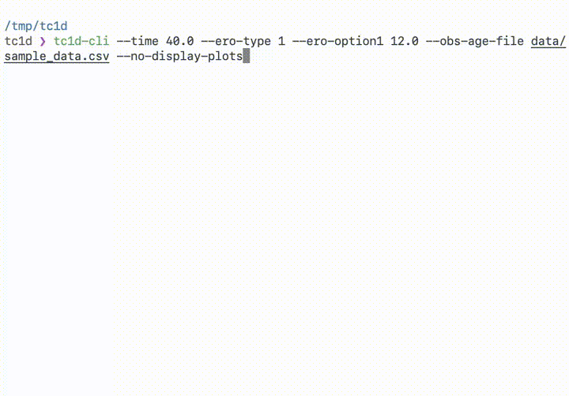

T\ :sub:`c`\ 1D documentation
=============================

T\ :sub:`c`\ 1D is a one-dimensional thermal and thermochronometer age prediction model that can simulate the effects of various geodynamic and geomorphic processes on thermochronometer ages.
It supports forward and inverse modeling of apatite and zircon (U-Th)/He and fission-track ages.

|
Check out the :doc:`getting started page <getting-started>` and the :doc:`user guide <user-guide>` for further information, including
details about :ref:`installation <installation>`.

.. admonition:: Attribution

   Use of T\ :sub:`c`\ 1D can be acknowledged by citing

   Whipp, D. M., Gérard, B., Laaksonen, S., and Kellett, D. A.: Technical note: Tc1D – a 1D thermal and thermochronometer age prediction model, Geochronology, 8, 627–643, https://doi.org/10.5194/gchron-8-627-2026, 2026.

   We also encourage you to `cite the relevant version of Tc1D <https://doi.org/10.5281/zenodo.7124271>`_ using the DOI from Zenodo.

.. admonition:: Acknowledgement

   We acknowledge Saska Dönges from the `University of Helsinki Research Software Engineering (UH-RSE) <https://wiki.helsinki.fi/xwiki/bin/view/Research%20Software%20Engineering%20group/>`_ for scientific computing support.

Contents
--------

.. toctree::
   :caption: Using Tc1D
   :maxdepth: 2

   getting-started
   user-guide
   example-plots

.. toctree::
   :caption: Reference
   :maxdepth: 2

   reference
